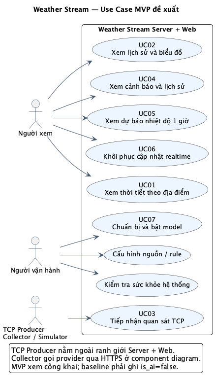
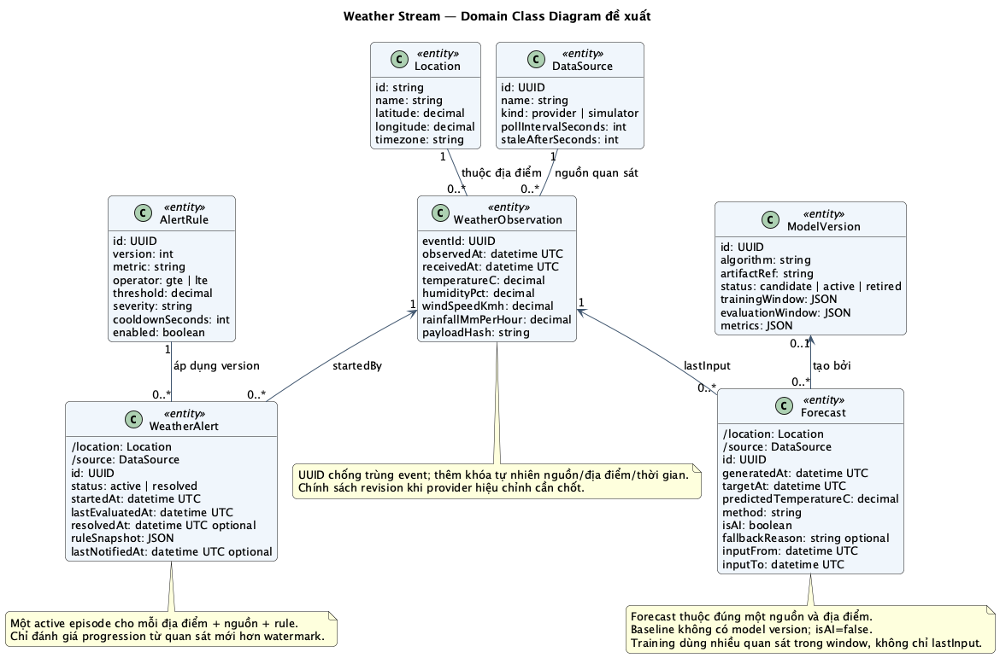
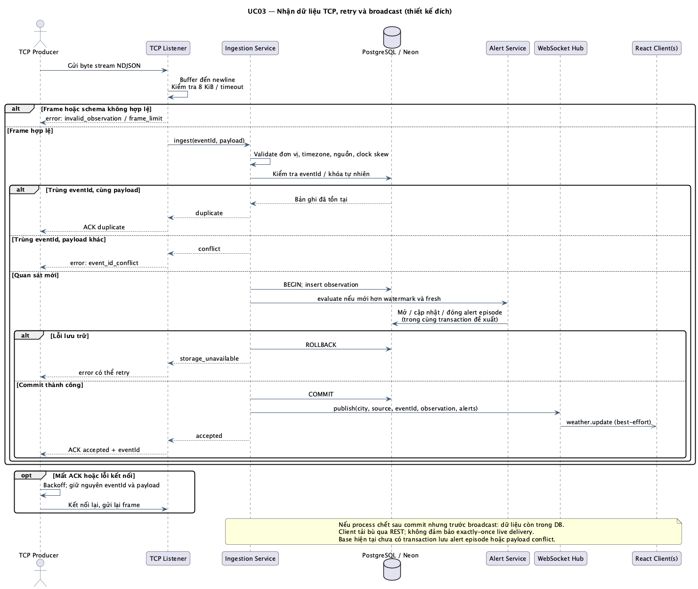
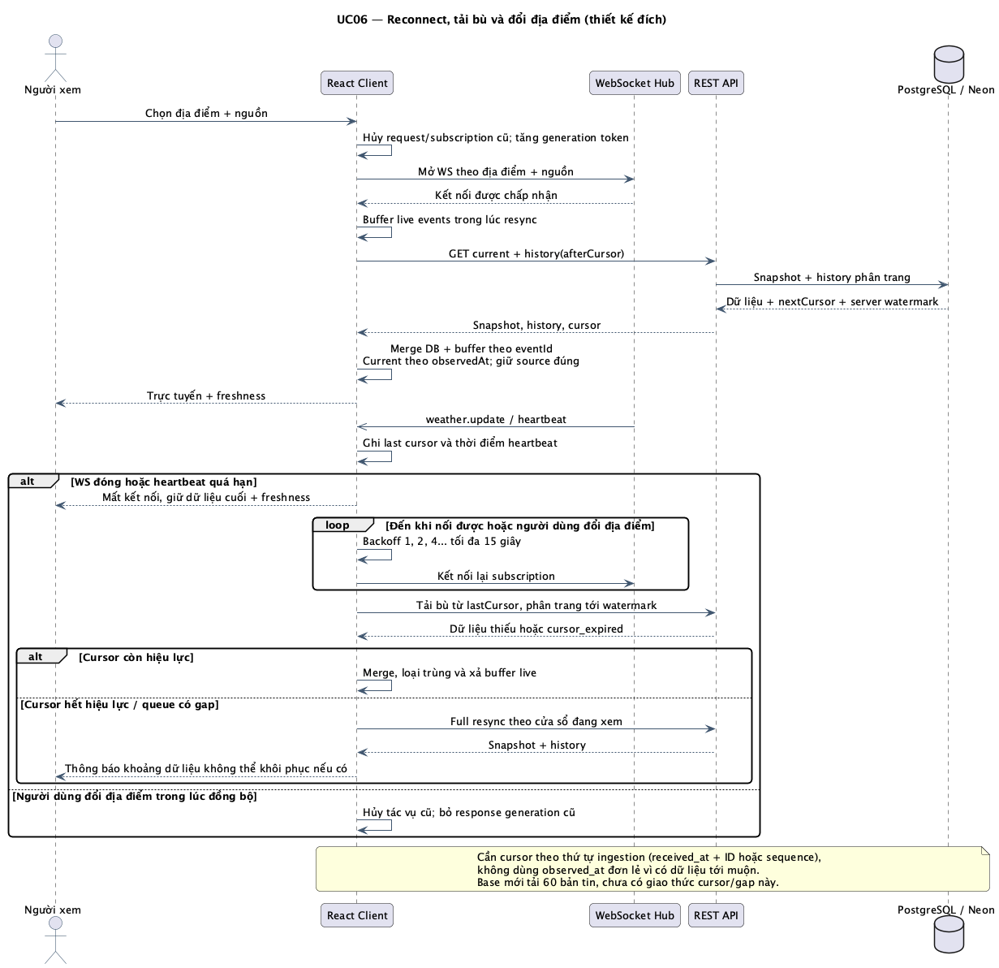
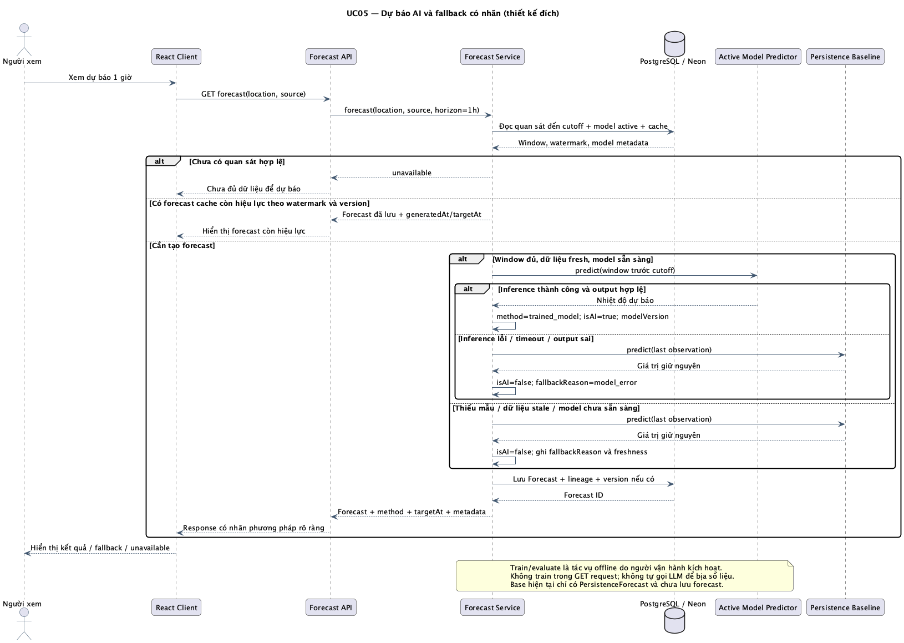
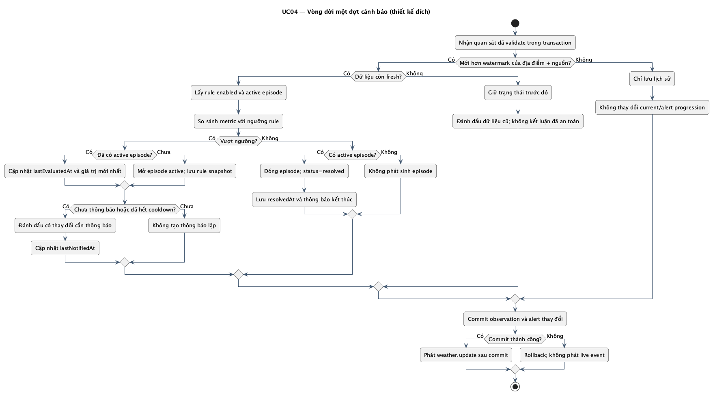
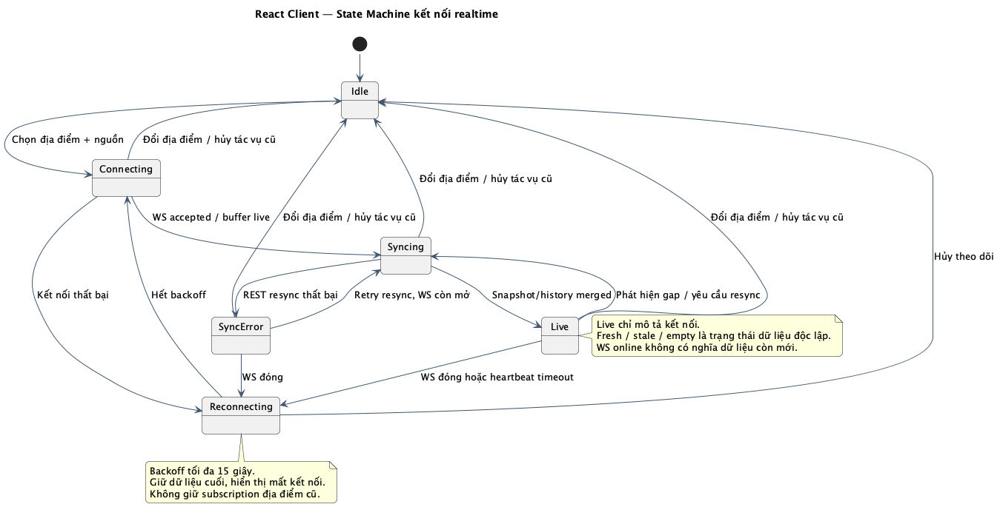
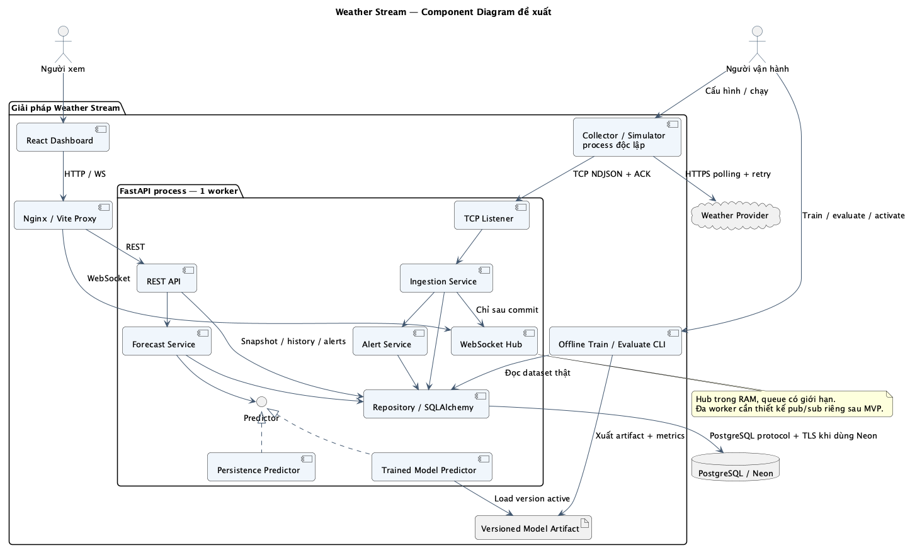
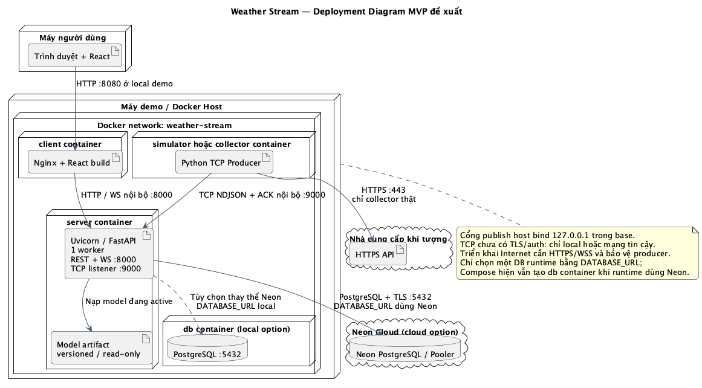

# Weather Stream — Thiết kế UML

Phiên bản 0.1 · Ngày 20/10/2026 · Trạng thái: **đề xuất để review, chưa phải thiết kế đã duyệt**.

Đọc cùng [Phân tích nghiệp vụ](01_PHAN_TICH_NGHIEP_VU.md). Sơ đồ mô tả **MVP đích**, bao gồm
những chức năng chưa được code trong base. Không dùng sơ đồ này để khẳng định các bảng hoặc API mới
đã tồn tại. Không có thay đổi database hay mã ứng dụng trong lần thiết kế này.

## 1. Cách đọc và nguồn chỉnh sửa

Bộ thiết kế dùng UML với nguồn **PlantUML**, ảnh PNG để đọc trực tiếp và SVG để phóng to/chèn báo cáo.
Đây là các use case, class, sequence, activity, state machine, component và deployment diagram;
không gọi ERD hay flowchart kiến trúc là UML use case.

| Sơ đồ | Mục đích | Nguồn | Bản vector |
|---|---|---|---|
| 01 · Use Case | Ai dùng hệ thống, để làm gì | [PlantUML](uml/source/01-use-case.puml) | [SVG](uml/rendered/01-use-case.svg) |
| 02 · Domain Class | Khái niệm nghiệp vụ và quan hệ | [PlantUML](uml/source/02-domain-class.puml) | [SVG](uml/rendered/02-domain-class.svg) |
| 03 · Sequence ingestion | TCP, validation, transaction, ACK/retry và broadcast | [PlantUML](uml/source/03-sequence-ingestion.puml) | [SVG](uml/rendered/03-sequence-ingestion.svg) |
| 04 · Sequence reconnect | Đồng bộ snapshot/live, cursor và tải bù | [PlantUML](uml/source/04-sequence-reconnect.puml) | [SVG](uml/rendered/04-sequence-reconnect.svg) |
| 05 · Sequence forecast | AI inference, cache, fallback và lineage | [PlantUML](uml/source/05-sequence-forecast.puml) | [SVG](uml/rendered/05-sequence-forecast.svg) |
| 06 · Activity cảnh báo | Mở/cập nhật/đóng đợt vượt ngưỡng | [PlantUML](uml/source/06-activity-alert.puml) | [SVG](uml/rendered/06-activity-alert.svg) |
| 07 · State Machine | Vòng đời kết nối React client | [PlantUML](uml/source/07-state-client-connection.puml) | [SVG](uml/rendered/07-state-client-connection.svg) |
| 08 · Component | Trách nhiệm thành phần, provider và predictor | [PlantUML](uml/source/08-component.puml) | [SVG](uml/rendered/08-component.svg) |
| 09 · Deployment | Docker, cổng/giao thức, Neon và mạng tin cậy | [PlantUML](uml/source/09-deployment.puml) | [SVG](uml/rendered/09-deployment.svg) |

## 2. Use Case Diagram



Ranh giới use case là **Server + Web**. Người xem truy cập công khai; người vận hành dùng config/CLI;
producer là process ngoài gửi dữ liệu vào server. Provider xuất hiện ở component/deployment diagram
vì collector mới là thành phần trực tiếp gọi provider.

Các đường nối actor/use case là quan hệ tham gia; không suy ra thứ tự xử lý từ cách sắp xếp hình.
Không thêm `include`/`extend` chỉ để diễn tả mọi chức năng có liên quan: chức năng xem cảnh báo/dự báo
có thể được mở độc lập, không phải lần xem thời tiết nào cũng bắt buộc thực hiện chúng.

Luồng chính và ngoại lệ của UC01–UC07 được đặc tả trong tài liệu BA mục 6.

## 3. Domain Class Diagram



Các lớp biểu diễn miền nghiệp vụ, **chưa phải sơ đồ vật lý PostgreSQL**. Hai lớp Location/DataSource
thay cho chuỗi city/source khi mở rộng; WeatherAlert lưu một đợt cảnh báo; Forecast lưu kết quả và
lineage; ModelVersion lưu metadata, không chứa binary model trong từng dòng database.

- Mỗi Observation có đúng một địa điểm và một nguồn; một địa điểm/nguồn có nhiều quan sát.
- Mỗi Alert thuộc một rule version và quan sát khởi phát; địa điểm/nguồn được suy ra từ quan sát đó. Dấu `/` biểu thị thuộc tính dẫn xuất. Nhiều quan sát sau đó có thể cập nhật cùng đợt.
- Mỗi Forecast có đúng một nguồn/địa điểm suy ra từ quan sát đầu vào cuối, kèm cửa sổ input_from/input_to. Khi lưu DB có thể lưu thêm location/source FK để truy vấn, nhưng phải nhất quán với quan sát gốc.
- Một Forecast có 0 hoặc 1 ModelVersion: baseline không có model đã train; AI phải có version.
- Không dùng quan hệ composition cho các bản ghi độc lập: xóa Location không đồng nghĩa được phép xóa dây chuyền lịch sử.

Thiết kế vật lý tiếp theo cần chốt FK, CHECK, unique index, partial unique index cho active alert,
index lịch sử theo nguồn/địa điểm/thời gian và migration từ bảng `observations` hiện có.

## 4. Sequence — Thu thập TCP và broadcast



Điểm cần giải thích khi vấn đáp môn mạng:

1. TCP là luồng byte: dùng newline làm framing, không coi một lần đọc là một message.
2. Commit trước ACK accepted để retry không mất dữ liệu đã được công nhận.
3. Retry giữ nguyên UUID/payload; cùng UUID khác payload là conflict, cần bổ sung so với base.
4. Transaction và unique constraint phải bảo vệ cả trường hợp nhiều producer gửi trùng đồng thời;
   pre-check trong sơ đồ không thay thế constraint và xử lý lỗi race tại insert.
5. Broadcast chỉ sau commit. ACK không chứng minh mọi browser đã nhận live event; DB/history dùng để khôi phục.
6. Alert episode và observation nên được commit cùng transaction. Nếu không thực hiện atomic transaction,
   phải có reconciliation từ các observation đã lưu; base chưa có alert persistence/reconciliation.

## 5. Sequence — Reconnect và tải bù



Mở WS trước khi tải snapshot giúp thu được các live event trong lúc đồng bộ; chúng được buffer
rồi merge với REST theo event ID. Cursor phải dựa trên thứ tự ingestion, không chỉ thời điểm quan sát,
vì provider có thể trả dữ liệu cũ đến muộn. Sơ đồ yêu cầu phân trang tải bù và phát hiện gap;
base hiện chỉ giữ 60 bản tin ở UI và chưa cung cấp giao thức đầy đủ này.

Cursor contract, watermark, buffering và retention sẽ được chốt cùng thiết kế API trước khi code.
Đổi thành phố/nguồn phải hủy subscription và request trước đó; response cũ không được cập nhật màn hình mới.

## 6. Sequence — AI forecast và fallback



Người dùng không trực tiếp kích hoạt train. Service đọc lịch sử đến cutoff, dùng model đang active
và trả metadata để giải thích kết quả. Nếu inference không thực hiện được, baseline phải có `is_ai=false`
và lý do fallback. Không có quan sát thì unavailable, không sinh số liệu thay thế.

Cache cần khóa gồm địa điểm, nguồn, watermark đầu vào, horizon và model version. ModelVersion chỉ
được đánh giá trên dữ liệu thật theo thời gian, so sánh với persistence trên cùng test window.
`generated_at` là thời điểm phát hành; thiết kế đích đề xuất `target_at = generated_at + 1 giờ`.
Dữ liệu stale phải được ghi nhãn trong kết quả; thời điểm quan sát đầu vào không bị đổi thành thời điểm hiện tại.
Base hiện neo target vào thời điểm quan sát +1 giờ; cần thống nhất/chuyển đổi hợp đồng khi triển khai forecast mới.

## 7. Activity — Cảnh báo



Rule áp dụng trên metric chuẩn hóa. Một lần vượt ngưỡng không phải một bản ghi cảnh báo mới cho
mọi message: dùng episode active/resolved và cooldown cho việc thông báo. Quan sát đến muộn chỉ bổ sung
lịch sử, không làm trạng thái cảnh báo hiện tại lùi thời gian. Khi không có dữ liệu mới, không tự đóng
cảnh báo vì không thể kết luận chỉ số đã trở lại bình thường.

## 8. State Machine — Kết nối client



Trạng thái kết nối và trạng thái dữ liệu độc lập:

| Kết nối | Dữ liệu | Hiển thị mong muốn |
|---|---|---|
| Live | Fresh | Trực tuyến, số liệu/thời gian cập nhật |
| Live | Stale | Kết nối còn hoạt động, nguồn chưa cập nhật |
| Reconnecting | Fresh hoặc stale | Đang thử kết nối lại, giữ giá trị cuối và timestamp |
| Bất kỳ | Empty | Chưa có dữ liệu; không hiển thị giá trị 0 thay cho thiếu dữ liệu |
| SyncError | Có dữ liệu cũ | Đồng bộ lỗi, cho retry, không coi là đã tải bù đầy đủ |

Base có reconnect cơ bản nhưng chưa đủ tất cả trạng thái/heartbeat watchdog được đề xuất.

## 9. Component Diagram



Ranh giới trách nhiệm:

- Collector xử lý provider, retry, chuẩn hóa và ID ổn định; simulator phục vụ test/demo riêng.
- Listener chỉ xử lý TCP/framing/ACK; ingestion điều phối validation/idempotency/transaction.
- Alert service quản lý rule/episode; forecast service chọn predictor và metadata.
- Predictor có thể là baseline hoặc model đã train; không nhúng logic model trực tiếp vào router.
- Repository/SQLAlchemy làm việc với DB; hub chịu trách nhiệm fan-out cho subscriber.
- Pipeline offline tạo artifact và kết quả đánh giá; process phục vụ chỉ load/infer model đang active.

Trong base, TCP listener và WS hub cùng process, vì vậy giữ **1 Uvicorn worker**.
Chưa thêm Redis/Kafka hoặc tách microservice trong MVP.

## 10. Deployment Diagram



Ứng dụng chọn database bằng `DATABASE_URL`: Neon **hoặc** PostgreSQL local. Diagram thể hiện hai lựa chọn,
không có đồng bộ hai chiều giữa chúng. Compose hiện vẫn tạo container db local khi URL runtime là Neon;
đây là khác biệt giữa cấu hình chạy sẵn và triển khai cloud tối giản.

Mạng Internet cần HTTPS/WSS; raw TCP trong base chỉ bind localhost/mạng tin cậy. Không đưa credentials
vào sơ đồ hoặc tài liệu. Collector không nhất thiết là API provider streaming: HTTPS polling đầu vào và
streaming TCP/WS bên trong là hai cơ chế khác nhau.

## 11. Ma trận truy vết

| Yêu cầu BA | Use case | Sơ đồ thiết kế | Tình trạng base |
|---|---|---|---|
| FR01–FR03 | UC01, UC02 | 01, 02, 04, 08 | Có thành phố/current/history; chưa đủ biểu đồ/lọc/phân trang |
| FR04–FR05 | UC03 | 02, 03, 08, 09 | Có simulator/TCP; chưa có collector thật, payload conflict/khóa tự nhiên |
| FR06–FR07 | UC01, UC06 | 03, 04, 07, 08 | Có WS/reconnect; chưa có gap/cursor/freshness đầy đủ |
| FR08–FR09 | UC04 | 02, 03, 06 | Có ngưỡng tức thời; chưa có alert rule/episode/history persistence |
| FR10–FR11 | UC05, UC07 | 02, 05, 08 | Chỉ baseline, chưa model/đánh giá/lưu forecast |
| FR12–FR13 | Vận hành, UC07 | 01, 08, 09 | Có health DB và config; cần health nguồn/activation model/rule |

## 12. Review trước khi code tiếp

- [ ] Chốt scope tài khoản và người vận hành.
- [ ] Chốt provider, cadence, nguồn dữ liệu train và horizon forecast.
- [ ] Chốt ngưỡng/freshness/cooldown, clock skew và xử lý revision dữ liệu provider.
- [ ] Duyệt class diagram và các unique constraint trước khi viết migration mới.
- [ ] Duyệt event/API contract cho source ID, cursor, gap, alert episode và forecast metadata.
- [ ] Chốt phân công: tài liệu hiện tại đang có hai cách gán Thắng/Đức trái nhau; chưa tự sửa.

## 13. Kết xuất lại sơ đồ

Nguồn chỉnh sửa chính nằm ở `uml/source/*.puml`; không sửa trực tiếp ảnh.
Dùng PlantUML CLI đã có trên máy hoặc một file JAR PlantUML và Java 17+:

```bash
java -Djava.awt.headless=true -jar /path/to/plantuml.jar -charset UTF-8 -failfast2 -tsvg -o ../rendered docs/uml/source/*.puml
java -Djava.awt.headless=true -jar /path/to/plantuml.jar -charset UTF-8 -failfast2 -tpng -o ../rendered docs/uml/source/*.puml
```

Các nguồn đặt `!pragma layout smetana` để layout trong Java, không cần cài Graphviz hoặc gửi source
lên máy chủ render bên ngoài. Bộ ảnh đi kèm đã được kết xuất từ nguồn trong lần thiết kế này.
