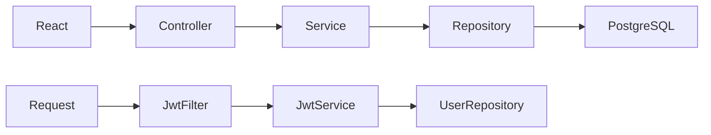
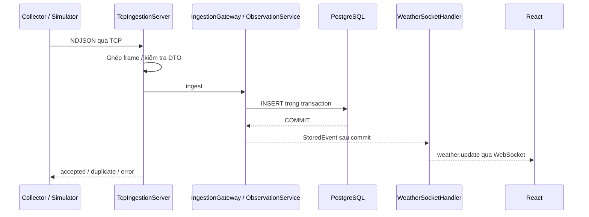

# Backend Weather Stream — Spring Boot

Java 17, Spring Boot 3.5, Spring Security, Spring Data JPA, PostgreSQL/Neon, TCP và WebSocket. Cách chia lớp tham khảo dự án `smart-stay`: constructor injection (`@RequiredArgsConstructor`), controller mỏng, service xử lý nghiệp vụ, repository truy vấn database. DTO tách khỏi entity để không trả mật khẩu ra API.

## Chạy nhanh

Cần Java 17+ và Maven 3.6.3+. Mở terminal tại `source/server`:

```sh
cp .env.example .env
# Điền DATABASE_URL và JWT_SECRET vào .env
mvn test
mvn spring-boot:run
```

`.env` được Spring đọc từ working directory. DATABASE_URL nhận cả URL Neon `postgresql://...?...` và URL cũ `postgresql+psycopg://...`; hỗ trợ JDBC qua DB_USER/DB_PASSWORD. Không đưa thông tin thật vào Git. Database Neon đã ở schema Alembic `0004` dùng lại được; không reset mật khẩu, không đổi ID hay xóa dữ liệu. Database cũ chưa lên `0004` cần nâng cấp bằng phiên bản Python cũ trước khi chuyển.

Khởi động bình thường dùng `ddl-auto=none`: không sửa schema. Khởi tạo **database mới** và nạp 34 tỉnh/3.321 xã bằng lệnh riêng:

```sh
mvn spring-boot:run -Dspring-boot.run.profiles=init-db -Dspring-boot.run.arguments="--spring.main.web-application-type=none --weather.enable-tcp=false"
```

Profile này tạo bảng nếu chưa tồn tại, chèn địa danh chưa có và thoát. Không tự chạy khi start server. Nếu dùng Neon đã có dữ liệu thì không cần bước này.

- REST: http://localhost:8000/api/v1/health
- Swagger: http://localhost:8000/docs
- TCP NDJSON: `127.0.0.1:9000`
- WebSocket: `ws://localhost:8000/api/v1/ws/wards/00004/weather`

## Luồng code để đọc và thuyết trình



1. `controller/`: nhận URL, query/body, kiểm tra DTO bằng `@Valid`, gọi service và bọc `ApiResponse`. Không chứa SQL hay mã JWT.
2. `dto/`: định nghĩa dữ liệu gửi/nhận. JSON dùng snake_case để tương thích React; Java dùng camelCase.
3. `service/`: quyết định nghiệp vụ: email trùng, địa danh hợp lệ, chuẩn hóa lượng mưa, cache dự báo, đánh giá cảnh báo. Ghi DB đặt trong transaction.
4. `repository/`: interface `JpaRepository`, Spring tạo implementation. Ví dụ `findFirstByWardIdAndSourceOrderByObservedAtDescIdDesc` lấy quan sát mới nhất đúng nguồn.
5. `entity/`: ánh xạ các bảng `users`, `provinces`, `wards`, `observations`. Timestamp dùng `Instant`/UTC.
6. `security/`: xác minh chữ ký JWT HS256, issuer/audience, thời hạn và `token_version`, sau đó đặt user vào SecurityContext.
7. `config/`: Spring Security stateless, CORS, WebSocket, datasource và profile khởi tạo DB.
8. `exception/`: trả lỗi theo `{success:false,data:null,error:{code,message,details}}`.
9. `network/`: TCP server, WebSocket handler và collector Java tùy chọn.

### Đăng ký / đăng nhập

`AuthController → AuthService → UserRepository`. Register chuẩn hóa email, hash Argon2id rồi lưu user. Login so sánh hash và trả JWT. Không trả `password_hash` trong DTO. Hash Argon2 cũ từ Python được giữ nguyên và có kiểm thử tương thích.

### Request cần đăng nhập

`Authorization: Bearer <token> → JwtFilter → JwtService → UserRepository → Controller → Service`. `/auth/me`, `/auth/logout`, `/users/me/address` yêu cầu JWT. Xem địa danh, thời tiết và dự báo là công khai. Logout tăng `token_version` trong DB, thu hồi các token cũ của user.

### Streaming cho môn lập trình mạng



TCP là byte stream: đọc đến newline, giới hạn frame 8 KiB, idle timeout 60 giây, tối đa 64 client TCP. Event UUID cũ cùng dữ liệu trả `duplicate`; cùng UUID khác dữ liệu trả `event_conflict`. Không phát WebSocket lại cho duplicate. WS có heartbeat 15 giây, origin allowlist và giới hạn buffer gửi. Chạy một JVM để TCP và WS dùng chung hub.

### Open-Meteo

`WeatherController → CurrentWeatherService / ForecastService → OpenMeteoClient`.

- Current: kiểm tra quan sát trong bucket 15 phút; nếu thiếu gọi Open-Meteo, chuẩn hóa lượng mưa từ mm/interval thành mm/h, lưu và phát WS. Có fallback bản ghi cũ khi provider lỗi và chờ 60 giây trước khi thử lại.
- Preview: dự báo giờ tiếp theo, gộp request đang chạy (2 worker, tối đa 32 request khác nhau), cập nhật mốc nếu qua giờ trong khi tải. Không cache kết quả đã xong và không ghi vào bảng quan sát.
- Future: lấy 168 giờ tương lai cho phường/xã, cache 15 phút.
- Provider forecast: dự báo theo giờ/ngày cho Hà Nội, Đà Nẵng, TP.HCM, 1–16 ngày, cache 15 phút.
- Kiểm tra đơn vị, mảng và phạm vi giá trị từ provider. Không gắn nhãn AI cho dự báo Open-Meteo. Cảnh báo heat/rain/wind là luật ngưỡng demo.

Catalog có cache 10 phút và trả header `X-Data-Stale: true` khi phải dùng cache cũ do DB lỗi.

## Collector Java có outbox

Trong cùng JVM với backend:

```sh
COLLECTOR_WARD_IDS=00004,00008 mvn spring-boot:run -Dspring-boot.run.profiles=collector
```

Collector lấy current cho danh sách xã chỉ định mỗi 15 phút, ghi JSON xuống `.collector/outbox/`, gửi TCP và chỉ xóa file sau ACK accepted/duplicate. Khởi động lại sẽ thử gửi file còn tồn. Event lỗi vĩnh viễn chuyển `.rejected`. Không mặc định thu thập cả nước. Nếu còn SQLite outbox của collector Python, dừng collector cũ rồi xuất bằng công cụ một lần (không sửa SQLite nguồn):

```sh
python source/verification/export_legacy_outbox.py DUONG_DAN_OUTBOX.sqlite3 DUONG_DAN_JAVA_OUTBOX
```

Chạy lệnh từ root repository. Công cụ giữ cả payload xung đột cùng UUID và trạng thái rejected. Java chỉ xóa file sau ACK đúng event ID; sender có backoff 1–60 giây và hoạt động độc lập với vòng lấy dữ liệu.

Collector hỗ trợ batch tối đa 50 xã/request, outbox giới hạn bởi `COLLECTOR_MAX_PENDING` (mặc định 10.000). Chỉ bật toàn bộ xã khi chủ động đặt `COLLECTOR_ALL_WARDS=true` và để trống `COLLECTOR_WARD_IDS`. Nút Run tương ứng: `python main.py --collector --all-wards`.

Nhập/cập nhật một snapshot địa danh đầy đủ, tương đương công cụ import FastAPI cũ:

```sh
# Tại source/server; mặc định dry-run, kiểm tra checksum, version, mã trùng và tọa độ
mvn spring-boot:run -Dspring-boot.run.profiles=import-catalog -Dspring-boot.run.arguments="--spring.main.web-application-type=none --weather.enable-tcp=false"
# Chủ động áp dụng: thêm biến CATALOG_APPLY=true.
# Snapshot riêng: CATALOG_SNAPSHOT=/path/snapshot.json và CATALOG_MANIFEST=/path/manifest.json
```

Apply cập nhật/khôi phục mã hiện có, thêm mã mới, vô hiệu hóa mã bị loại; không xóa user, địa chỉ hoặc quan sát cũ. Tất cả chạy trong một transaction.

## Chạy bằng nút Run

**IntelliJ IDEA:** mở `pom.xml`, chọn JDK 17, Run `WeatherApplication.main()`, working directory `source/server` để đọc `.env`. Đặt breakpoint lần lượt ở controller, service, repository/JWT filter để theo dõi luồng.

**PyCharm:** nút Run ở root `main.py` vẫn là launcher tương thích, khởi chạy Maven và React; cần `mvn`, `java`, `npm` có trong PATH. Debug Java dùng IntelliJ. `python main.py --check` chỉ kiểm tra công cụ. `python main.py --collector --ward-id 00004` bật collector.

## Kiểm thử

```sh
mvn test
mvn package
```

Kiểm thử dùng H2 ở chế độ PostgreSQL và cổng HTTP/TCP ngẫu nhiên; không truy cập Neon. Có kiểm thử REST auth/địa chỉ/catalog, thu hồi token, tương thích Argon2/UUID Python, TCP phân mảnh/trùng/xung đột/giới hạn frame và WebSocket sau commit. Open-Meteo được giả lập trong kiểm thử parser để chạy ổn định. Đã kiểm chứng đối chiếu với FastAPI trên PostgreSQL thật; xem `docs/08_KIEM_TRA_TUONG_DUONG_SPRING_BOOT.md` ở root dự án. Smoke 100 phiên là bài ngắn, vẫn cần đo JMeter dài hạn trước khi kết luận sức tải; bằng chứng JMeter cũ chỉ áp dụng bản Python.
